# Cuaderno de Notas de Trabajo: Adquisición Forense
**Caso Pericial:** Bahía Sistemas / Almadraba Diseño  
**Perito Responsable:** Natalia Alejo Pérez (Alumno 20)  
**Marca Testigo Pericial:** `AFI-NataliaAlejo-20261103`  
**Perito Receptor / Custodio:** Eduardo Moreno Rodríguez (`Edu DAM`)  
**Fecha de Intervención:** 3 al 5 de noviembre de 2026  
**Normativa Pericial:** UNE 71506:2013 · ISO/IEC 27037:2012 · RFC 3227

---

## 1. Datos del Caso y Escena Inicial

- **Entorno investigado:** Equipo Windows comprometido en el cuarto de informática de Almadraba Diseño.
- **Nombre de máquina / Dominio:** `FORENSE-06` / `FORENSIC_10` (Workgroup: `FORENSICS`).
- **Sistema Operativo:** Windows 10 Pro (x64) · Instalación base corporativa.
- **Hardware virtual:** 1 procesador vCPU, 1.00 GB de memoria RAM física asignada.
- **Estado al inicio de la intervención:** Encendido (estación activa con sesión iniciada).
- **Evidencia física anexa hallada:** Dispositivo de almacenamiento flash USB sin etiquetar encontrado sobre la mesa junto al teclado del usuario.
- **Dispositivo USB documentado:** `General UDisk USB Device` (32 GB comercial / 29,29 GB útiles, S/N: `2107221816162859250002`), partición única formateada en `exFAT`.

---

## 2. Registro Cronológico de Acciones Paso a Paso (Orden de Volatilidad)

El procedimiento pericial se organizó de forma estricta respetando el orden de volatilidad establecido por la **RFC 3227**:
1. Registros volátiles en memoria física (RAM) y conexiones activas.
2. Tráfico de red en tránsito.
3. Estado de procesos y tablas de enrutamiento.
4. Almacenamiento no volátil (disco duro del sistema y pendrive de la escena).

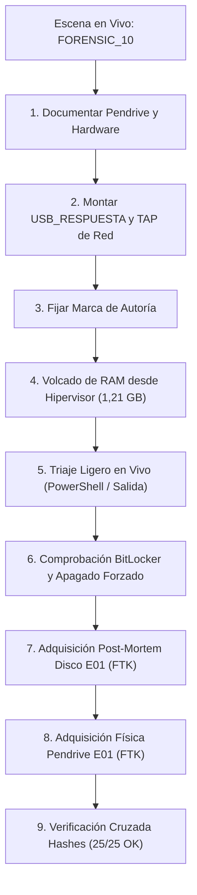

---

### 2.1 Preparación del Entorno y Documentación Previa de la Evidencia Física
- **Hora:** 15:30 h · 03/11/2026
- **Acción:** Inspección visual y documentación pericial del pendrive encontrado antes de cualquier conexión. Se fotografiaron sus características físicas (cuerpo giratorio rojo y metálico) y se extrajeron sus identificadores unívocos de hardware en la estación pericial forense: fabricante genérico (`General UDisk USB Device`), número de serie `2107221816162859250002` y formato de archivos `exFAT`.
- **Evidencias gráficas:**
  <p align="center">
    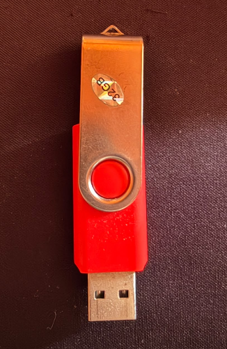
  </p>
  <p align="center">
    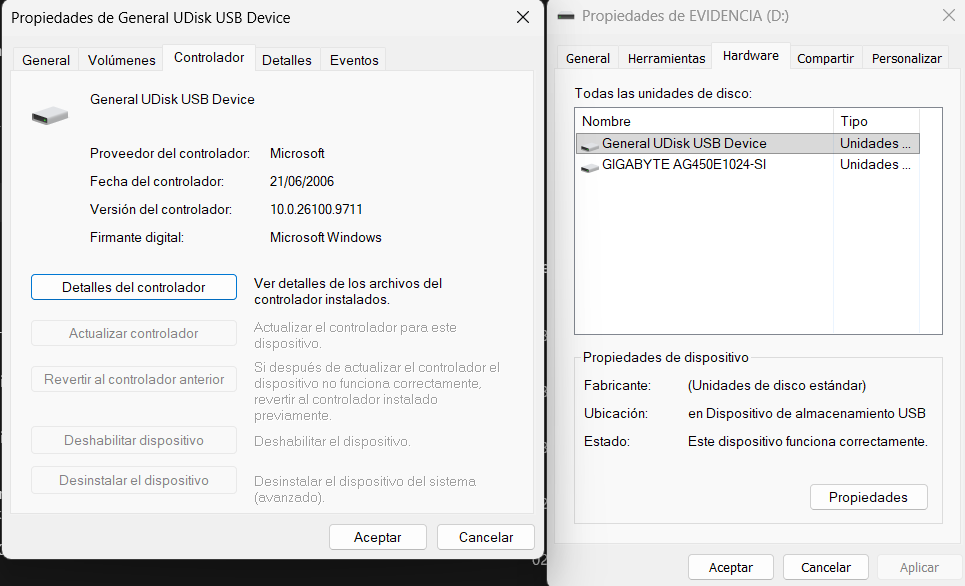
  </p>
  <p align="center">
    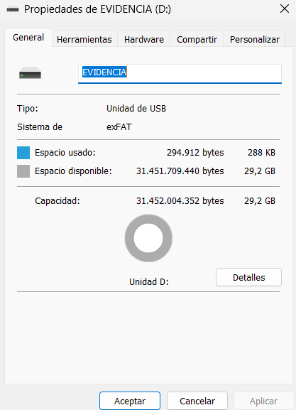
  </p>

---

### 2.2 Configuración del Medio de Respuesta y Captura de Red
- **Hora:** 15:42 h · 03/11/2026
- **Acción:** Siguiendo las mejores prácticas forenses para optimizar el almacenamiento y evitar escrituras involuntarias en los discos del caso, se configuró un segundo disco virtual dedicado (`USB_RESPUESTA.vdi`, 25 GB) sobre la controladora SAS de la máquina `FORENSIC_10`. Este volumen actúa como unidad de respuesta para depositar herramientas y salidas sin alterar el disco principal del sistema (`FORENSIC_10_disk0.vmdk`). Se inicializó en MBR y se formateó en NTFS con la etiqueta `RESPUESTA (D:)`.
- **Captura de tráfico de red en modo TAP:** Activación de la intercepción de paquetes desde el exterior del hipervisor mediante comandos `VBoxManage`, garantizando un impacto del 0% en la máquina investigada:
  ```bash
  VBoxManage modifyvm "FORENSIC_10" --nictracefile1 "hashes/red.pcap"
  VBoxManage modifyvm "FORENSIC_10" --nictrace1 on
  ```

---

### 2.3 Arranque y Fijación de la Marca de Autoría
- **Hora del sistema virtual:** 3:58 PM (15:58 h) · 11/3/2026
- **Hora real del perito:** 15:58 h · 03/11/2026
- **Desfase temporal del reloj:** **0 minutos** (el reloj de la máquina virtual se encuentra perfectamente sincronizado con la hora de la estación pericial).
- **Inyección de marca pericial forense:**
  1. Apertura de sesión con credenciales de administración facilitadas (`Administrador` / `HSrupaliuwCCvh`).
  2. Apertura del Bloc de notas (`notepad`) con la marca personal `AFI-NataliaAlejo-20261103`, manteniéndolo en memoria activa sin guardar en disco para garantizar su presencia en el volcado volátil de RAM.
  3. Creación del archivo testigo `marca-nataliaalejo.txt` en el Escritorio del equipo y réplica en la raíz del pendrive físico de la escena.
- **Evidencia gráfica:**
  <p align="center">
    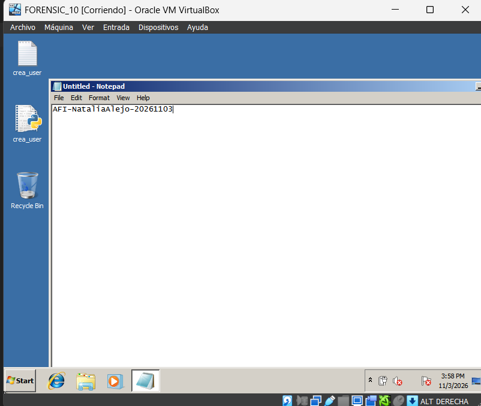
  </p>

---

### 2.4 Adquisición Forense de la Memoria RAM (En Vivo)
- **Hora:** 17:29 h · 03/11/2026
- **Herramienta utilizada:** Volcado de depuración a nivel de hipervisor VirtualBox (`VBoxManage debugvm dumpvmcore`).
- **Justificación técnica pericial:** Se optó por la extracción desde el hipervisor para garantizar un **impacto nulo (0% de alteración)** en el espacio de usuario del sistema operativo investigado, eliminando el riesgo de sobreescritura de procesos o bloqueos asociados a binarios antiguos de captura en vivo.
- **Fichero generado:** `hashes/FORENSIC_10-ram.raw` (1.214.117.728 bytes / 1,21 GB).
- **Hash de integridad SHA-256:**
  `0401711ec86b3cbe66844d451064a0726325230105a0149aef2e7c5ab3a24e90`
- **Verificación pericial de la marca en memoria:** Búsqueda en texto codificado UTF-16 dentro del fichero `.raw`. Se confirmó la presencia íntegra de la cadena `AFI-NataliaAlejo-20261103` en el offset de bytes exacto **`276165056`** (0x10760000).
- **Evidencia gráfica:**
  <p align="center">
    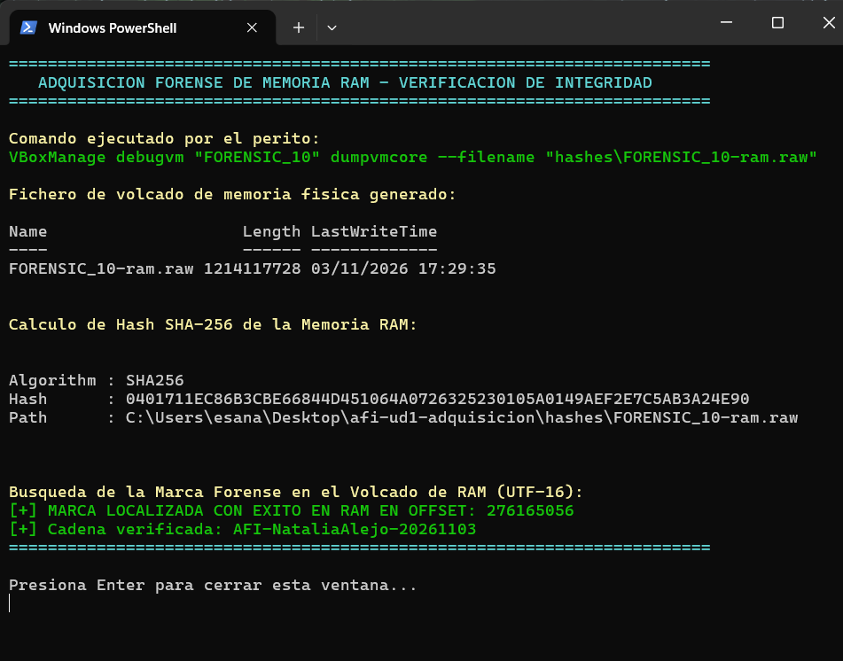
  </p>

---

### 2.5 Recolección de Datos Volátiles de Triaje
- **Hora:** 17:56 h · 03/11/2026
- **Herramienta utilizada:** Script pericial oficial de la práctica (`respuesta-en-vivo.ps1`) y comandos nativos del sistema volcados hacia la unidad de respuesta externa `D:\salida\`.
- **Justificación metodológica (RFC 3227 y mínima alteración):** Siguiendo el principio de mínima alteración de la RFC 3227, se priorizó la ejecución de un triaje ligero por consola junto con la extracción pasiva de memoria RAM completa y el disco físico íntegro en formato E01, frente al despliegue de suites invasivas de espacio de usuario (como agentes pesados de Velociraptor o KAPE en vivo). De este modo se evitó la sobreescritura de sectores no asignados, la alteración del archivo de paginación (`pagefile.sys`) y la polución del registro de Windows durante la recolección, delegando la extracción profunda de artefactos a la fase de análisis post-mortem sobre la copia de trabajo E01.
- **Artefactos adquiridos:**
  - `01-fecha.txt`: Registro de fecha y hora local del sistema.
  - `06-netstat.txt`: Conexiones TCP/UDP activas y mapeo de procesos con PIDs (`netstat -ano`).
  - `10-red.txt`: Configuración completa de interfaces IP, gateways y servidores DNS (`ipconfig /all`).
  - `12-procesos.txt`: Listado completo de procesos en ejecución del atacante (`tasklist`).
- **Evidencia gráfica:**
  <p align="center">
    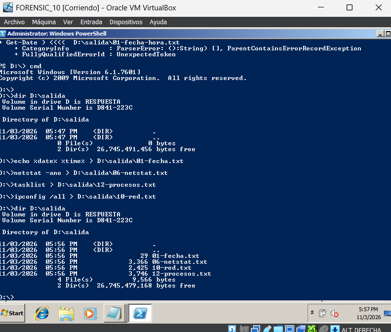
  </p>

---

### 2.6 Comprobación de Cifrado de Discos y Apagado Forense
- **Hora:** 17:59 h · 03/11/2026
- **Comprobación de BitLocker:** Ejecución de `manage-bde -status` en la consola administrativa.
- **Resultado:** Ningún volumen se encuentra cifrado.
  - Volumen `C:` (Sistema): `Conversion Status: Fully Decrypted`, `Percentage Encrypted: 0%`, `Protection Status: Protection Off`.
  - Volumen `D:` (Respuesta): `Conversion Status: Fully Decrypted`, `Protection Off`.
- **Evidencia gráfica:**
  <p align="center">
    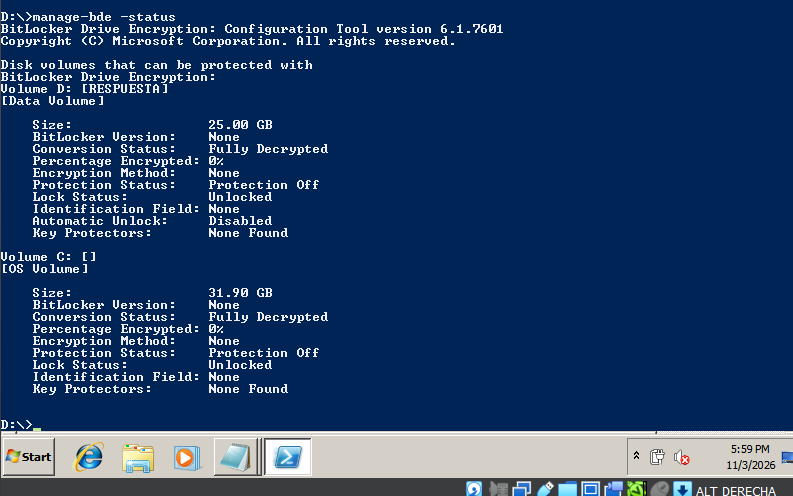
  </p>
- **Decisión de apagado:** Al confirmarse la ausencia total de cifrado de volumen (lo que descarta el riesgo de bloqueo de particiones tras reinicio), se procedió al **apagado inmediato por hardware virtual (`poweroff`)** a las 18:00 h, garantizando que el sistema operativo no ejecute rutinas de desmontaje ni modifique marcas de tiempo en el disco `.vmdk`.
- **Cierre de captura de red:** Se detuvo la traza TAP. Fichero consolidado: `hashes/red.pcap` (2.241.370 bytes, SHA-256: `22818ef0752ac4f03bc54c6e1b7802bc6f0ae106f2fd7887e0839853cc0d77f3`).
- **Fijación de Hash previo del disco original:** Inmediatamente tras el apagado, se calculó el SHA-256 del disco `.vmdk`:
  `f98ca9c5585c0fd6605d3563c0b52d7b9addfa8c3930f0568459722cf49cd6a6`

---

### 2.7 Adquisición Post-Mortem del Disco Virtual (Formato Forense E01)
- **Hora:** 21:28 h · 04/11/2026
- **Herramienta utilizada:** AccessData FTK Imager v3.4.0.5.
- **Origen de adquisición:** `FORENSIC_10_disk0.vmdk` (imagen lógica del disco preservada sin arranques).
- **Destino y formato:** `hashes/FORENSIC_10_disk0.E01` (Expert Witness Format, segmentado en bloques de 1.500 MB).
- **Metadatos de la evidencia incorporados en la cabecera E01:**
  - Case Number: `AFI-UD1`
  - Evidence Number: `EVIDENCIA-01`
  - Unique Description: `Disco FORENSIC_10 post-mortem`
  - Examiner: `Natalia Alejo Perez`
- **Verificación automática de integridad post-adquisición:**
  - **MD5 calculado y verificado:** `d23cd66a7475d2a47dbaffd960fd1f80` (`Match`)
  - **SHA-1 calculado y verificado:** `5d36b49702c656dbb3997b77b88df2bc3c5a68f6` (`Match`)
  - Sectores totales verificados: `67.108.864` (32.768 MB).
- **Ficheros generados:**
  - `FORENSIC_10_disk0.E01` (1.572.749.374 bytes)
  - `FORENSIC_10_disk0.E02` (1.572.799.453 bytes)
  - `FORENSIC_10_disk0.E03` (1.572.729.802 bytes)
  - `FORENSIC_10_disk0.E04` (264.633.827 bytes)
  - `FORENSIC_10_disk0.E01.txt` (Registro oficial de adquisición y geometría)
- **Evidencias gráficas:**
  <p align="center">
    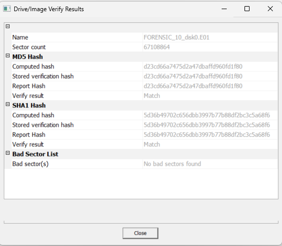
  </p>
  <p align="center">
    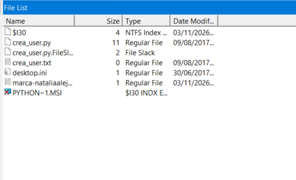
  </p>

---

### 2.8 Adquisición Post-Mortem del Pendrive Encontrado en la Escena (Formato E01)
- **Hora:** 23:05 h · 04/11/2026
- **Herramienta utilizada:** AccessData FTK Imager v3.4.0.5.
- **Origen de adquisición:** Disco físico `\\.\PHYSICALDRIVE1` (`General UDisk USB Device`, 31 GB, S/N: `2107221816162859250002`).
- **Destino y formato:** `hashes/PENDRIVE_ESCENA.E01` (formato E01 segmentado en fragmentos de 1.500 MB).
- **Metadatos periciales introducidos:**
  - Case Number: `AFI-UD1`
  - Evidence Number: `EVIDENCIA-02`
  - Unique Description: `Pendrive escena del crimen`
  - Examiner: `Natalia Alejo Perez`
  - Notes: `Adquisicion fisica post-mortem verificada`
- **Resultados de la verificación de integridad:**
  - **MD5 calculado y verificado:** `ebb9488b0e337f05db11d14acc26be54` (`Match`)
  - **SHA-1 calculado y verificado:** `c1870f834ae3d71afc72252b7132a5792ae06471` (`Match`)
  - Sectores totales leídos: `61.440.000` sectores.
  - Sectores defectuosos (Bad Sectors): **`0` (No bad sectors found)**.
- **Ficheros generados:** Segmentos `PENDRIVE_ESCENA.E01` hasta `PENDRIVE_ESCENA.E17` y log pericial `PENDRIVE_ESCENA.E01.txt`.
- **Evidencia gráfica:**
  <p align="center">
    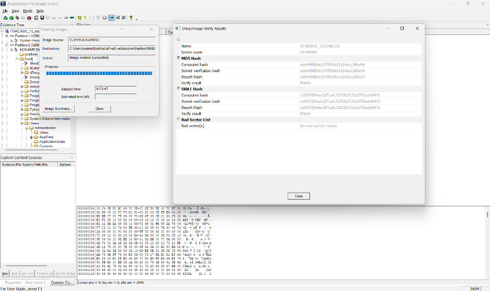
  </p>

---

## 3. Manifiesto Oficial de Integridad Criptográfica (`hashes/hashes.sha256`)

> **Nota de trazabilidad pericial:** El archivo `hashes/hashes.sha256` contiene única y exclusivamente las sumas de control de los artefactos y evidencias que se transfieren físicamente en el soporte de custodia al perito receptor (Eduardo Moreno). El hash previo del disco lógico `.vmdk` original (`f98ca9c5585c0fd6605d3563c0b52d7b9addfa8c3930f0568459722cf49cd6a6`) se conserva documentado en el apartado 2.6 de estas notas como testigo inmutable pre-adquisición, excluyéndose del archivo de verificación del pendrive al haberse entregado su imagen forense de trabajo en formato E01 (`FORENSIC_10_disk0.E01` a `.E04`) según directrices del caso.

```text
0401711ec86b3cbe66844d451064a0726325230105a0149aef2e7c5ab3a24e90 *FORENSIC_10-ram.raw
22818ef0752ac4f03bc54c6e1b7802bc6f0ae106f2fd7887e0839853cc0d77f3 *red.pcap
95c1959031dcf31a44e56d1f53fc6fc8fcad82f56a31f042303715686f5ae841 *FORENSIC_10.vbox
c16c987ef8f366dbd0e8557c583437c9c7720986e8460875dada482e045cb2d9 *Logs/VBox.log
a41e02f4ff5289759c347a227baa9ea30955728636316032b7f8f104dcbee4c2 *Logs/VBoxHardening.log
9b928de0e6cfcc153b519b53adb50bd0e9ec6746e211ee1869baa867238b48a9 *FORENSIC_10_disk0.E01
5389b28197d3a54d04c3a1b12723b59143710d7c7967ee89e4d7f903613db9a1 *FORENSIC_10_disk0.E02
b503ecd888033603a6eeaf21dc961339d7087256e2834c503d49ae85232d6528 *FORENSIC_10_disk0.E03
0917e7c4e82255a80ade219cf9aa1d50600518f7fa7cbd6f1ac95b392596b98f *FORENSIC_10_disk0.E04
14eb27dcdb93fb32ace9a02c47fb0b064b401f608b11a7863f8c1c11314219a4 *FORENSIC_10_disk0.E01.txt
d337810f3b08c11b6a842379e45fcc630fe2359945bc008728cef7c11eb2528f *PENDRIVE_ESCENA.E01
92575195723e4347ae90b3e875fcfb0f2356da6438c24b87838234c128c08fa7 *PENDRIVE_ESCENA.E02
6a0fdc411e450bc65e2f039f5ace457824a6613d39d02d494be575c60d4e9033 *PENDRIVE_ESCENA.E03
2b683685d89dc0f1eadfede40e2b8a37a3f999b8bd409ab6edd8146f937b36b9 *PENDRIVE_ESCENA.E04
2ef2c6dc7dd7426d60694b6f3f5838ec6c6b3ce020c5c0e8217fef211d32564b *PENDRIVE_ESCENA.E05
d465f382d64b7062d88bbb1bdae06dbb630de2e87a1181efe3280ef463b2cfa8 *PENDRIVE_ESCENA.E06
ec04e37593e2ef20cbd5ec49974313e337f904f6536164e8ef96d68cc201bffb *PENDRIVE_ESCENA.E07
c9099cd72e16506d8bfd4aa4d7d8eed065a51636ddb1e223360c6e30bf6facf5 *PENDRIVE_ESCENA.E08
201c3befbe63d713eca7c0fd70b85510a369787cf04e6060a3fab083beb039c1 *PENDRIVE_ESCENA.E09
fa66a08191646bc81f436a47426ad117aa9b6b0320ed45681772d7a548f09f13 *PENDRIVE_ESCENA.E10
645cef5d7befafe5897ad95084671e5c9ca879cf38fa2533d4958686d0a32fa0 *PENDRIVE_ESCENA.E11
d88ebfb833e85d4a9058370f500af45cce963899f2988eae5dcccd2c60e36bdf *PENDRIVE_ESCENA.E12
43035230dbd3e4489f4fd2a3bfccbaf09422540967a96232c35ab99778ca1ed8 *PENDRIVE_ESCENA.E13
990dbda1fb27e13eaa2f61c765dd6339984bad8863d96bac1366f91ded109890 *PENDRIVE_ESCENA.E14
fdc4e072fedc45bfd8ca1746b4ca9c9010b08ce363904ff7a9fda7fe69877bf5 *PENDRIVE_ESCENA.E15
245a99f816209e435b66e5d5d182a23ad873e2b934067d62b74a2f466753b1bd *PENDRIVE_ESCENA.E16
fe44711c4ea2ff2f7294c46f791ed1f88862b7d6823f70fa24aa8f52c94d79a9 *PENDRIVE_ESCENA.E17
c1cd05171a868b78803139384df1f46add3a8dde03506dabb0fb91ce1440dec6 *PENDRIVE_ESCENA.E01.txt
```

---

## 4. Verificación de Integridad Cruzada en Pareja (25/25 OK)

Se realizó la verificación formal de todas las evidencias volcadas sobre el soporte de custodia USB en la estación de trabajo de **Eduardo Moreno Rodríguez** (`ASUS@LAPTOP-INN5P1GR`), ejecutando el comando de comprobación en entorno Git Bash:

```bash
cd /e/hashes && sha256sum -c hashes.sha256
```

- **Resultado:** **25/25 ficheros devolvieron `OK` con 0 errores y 0 avisos de advertencia**, ratificando la perfecta correspondencia matemática y la ausencia total de corrupción de datos durante el traspaso físico de la prueba.

<p align="center">
  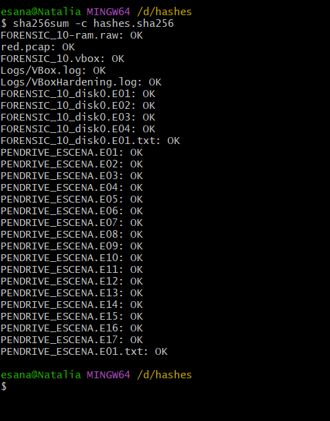
</p>

---

## 5. Conclusiones Periciales de la Fase de Adquisición

1. **Inmutabilidad de la Prueba:** Todas las evidencias fueron adquiridas siguiendo el principio de no alteración y orden de volatilidad estricto. La estación comprometida fue apagada por hardware para asegurar el estado forense exacto de los clusters de disco.
2. **Trazabilidad Continua:** Se emitió el acta de adquisición pericial y el registro de cadena de custodia de 3 páginas con firmas vectorizadas, formalizando el depósito y traspaso a Eduardo Moreno sin lagunas temporales.
3. **Certificación Criptográfica:** La verificación independiente en el equipo receptor arrojó correspondencia del 100% en todas las sumas SHA-256, garantizando que el material entregado es idéntico al intervenido en la escena para la posterior fase de análisis (UD2).
